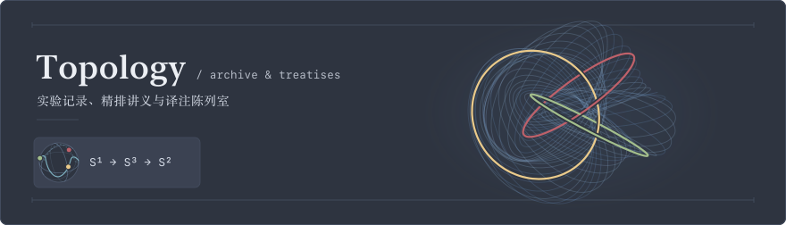

<!-- Generated by scripts/build_profile.py from manifest.toml. Do not edit manually. -->

<picture>
  <source media="(prefers-color-scheme: dark)" srcset="./assets/banner-dark.svg">
  <source media="(prefers-color-scheme: light)" srcset="./assets/banner-light.svg">
  
</picture>

 

<picture>
  <source media="(prefers-color-scheme: dark)" srcset="./assets/sec-bench-dark.svg">
  <source media="(prefers-color-scheme: light)" srcset="./assets/sec-bench-light.svg">
  
</picture>

| 条目 | 介质与核心不变量 | 入口 |
| :--- | :--- | :--- |
| **[gemma-4-developer-agent](https://github.com/LogosTopos/gemma-4-developer-agent)** | `Python · SWE-bench` — 围绕 Kaggle Gemma 4 评测框架之逆向剖析、零 GPU 本地验证工具链与声明式基线记录。 | [源码](https://github.com/LogosTopos/gemma-4-developer-agent) |
| **[parallel-distributed-computing](https://github.com/LogosTopos/parallel-distributed-computing)** | `C · MPI · OpenMP` — 并行与分布式数值实验，涵盖底层并发原语、消息传递通信剖析与吞吐对照记录。 | [源码](https://github.com/LogosTopos/parallel-distributed-computing) |
| **[dsh-std](https://github.com/LogosTopos/dsh-std)** | `Meta-Protocol · Harness` — Agent 插件互操作元协议、环境身份迁移规范与本地多模态受控评测装置。 | [源码](https://github.com/LogosTopos/dsh-std) |

<picture>
  <source media="(prefers-color-scheme: dark)" srcset="./assets/sec-treatises-dark.svg">
  <source media="(prefers-color-scheme: light)" srcset="./assets/sec-treatises-light.svg">
  
</picture>

| 条目 | 介质与核心不变量 | 入口 |
| :--- | :--- | :--- |
| **[Riemann-Surface-Lecture-Notes](https://github.com/LogosTopos/Riemann-Surface-Lecture-Notes)** | `LaTeX · 十四章讲义` — 黎曼曲面复习讲义，依香蕉空间底本重写与扩充，含十四章独立源码与统一合订本。 | [TeX 源码](https://github.com/LogosTopos/Riemann-Surface-Lecture-Notes) |
| **[math-analysis-notes](https://github.com/LogosTopos/math-analysis-notes)** | `LaTeX · 习题解答` — 谢惠民《数学分析习题课讲义》下册（Ch.13–26）与楼红卫数分讲义之方法整理与解答。 | [讲义与解答](https://github.com/LogosTopos/math-analysis-notes) |
| **[composing-programs-zh](https://github.com/LogosTopos/composing-programs-zh)** | `CS61A · 中文译稿` — UC Berkeley CS61A 教材 Composing Programs 中文逐章译稿与配套算例归档。 | [译本仓库](https://github.com/LogosTopos/composing-programs-zh) |

<picture>
  <source media="(prefers-color-scheme: dark)" srcset="./assets/sec-sketches-dark.svg">
  <source media="(prefers-color-scheme: light)" srcset="./assets/sec-sketches-light.svg">
  
</picture>

| 条目 | 介质与核心不变量 | 入口 |
| :--- | :--- | :--- |
| **[Fudan_iCourse_Subscriber](https://github.com/LogosTopos/Fudan_iCourse_Subscriber)** | `Python · ASR + LLM` — 课程录屏定时抓取、语音转写与摘要投递流水线，附本地直播流回环播放装置。 | [源码](https://github.com/LogosTopos/Fudan_iCourse_Subscriber) |
| **[epsilon-bit-ai-composer](https://github.com/LogosTopos/epsilon-bit-ai-composer)** | `Python · Symbolic Audio` — 八位芯片音乐符号生成与算法作曲小品。 | [源码](https://github.com/LogosTopos/epsilon-bit-ai-composer) |
| **[local-treatises-in-progress](https://github.com/LogosTopos)** | `XeLaTeX · 在编手稿` — 黎曼映照定理严格化重建、几何表示论与稳定包络讲义及《法哲学原理》导读札记。 | [源码](https://github.com/LogosTopos) |

Colophon · 题头 Hopf 纤维丛投影与分栏铭牌由仓库内 <a href="./scripts/hopf_geometry.py"><code>scripts/hopf_geometry.py</code></a> 按 Nord 极夜/雪暴规范生成。
